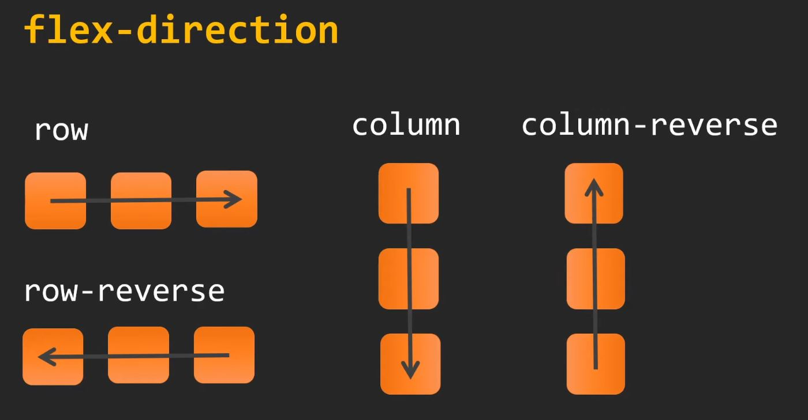
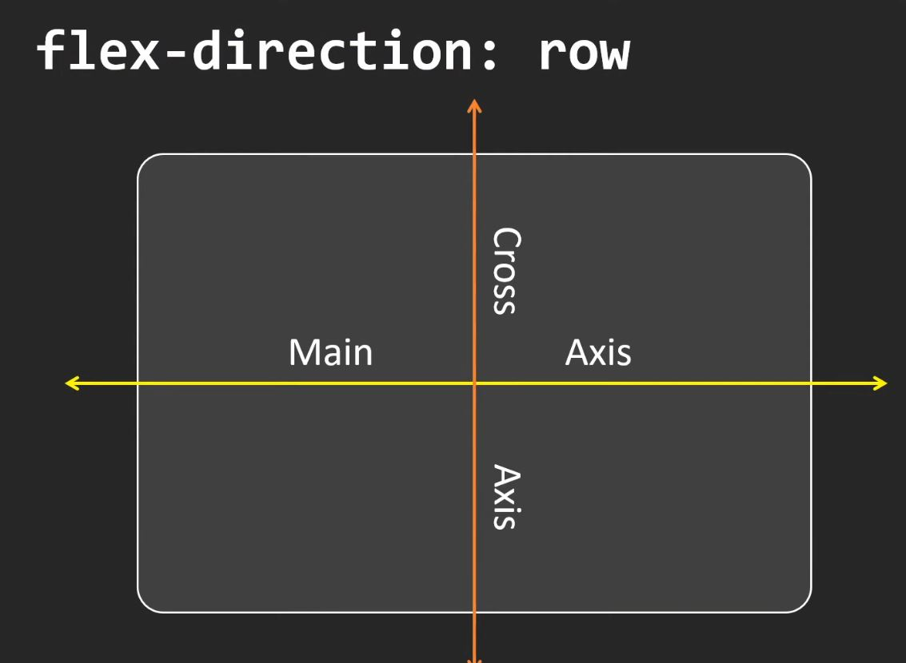
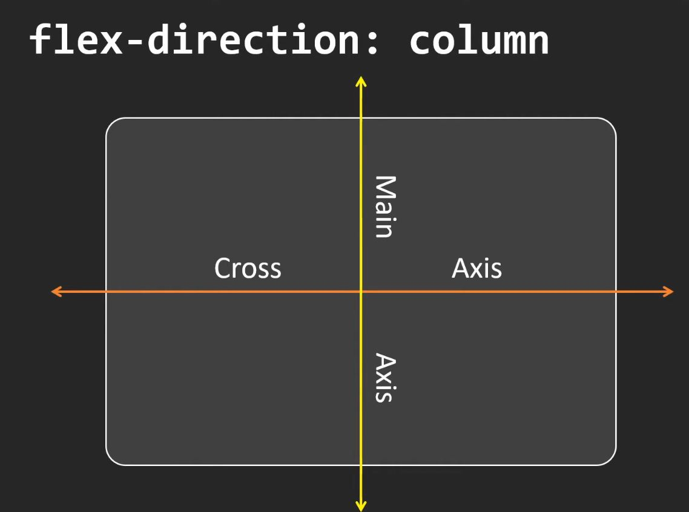
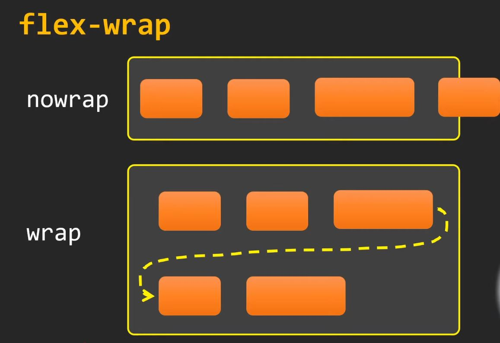
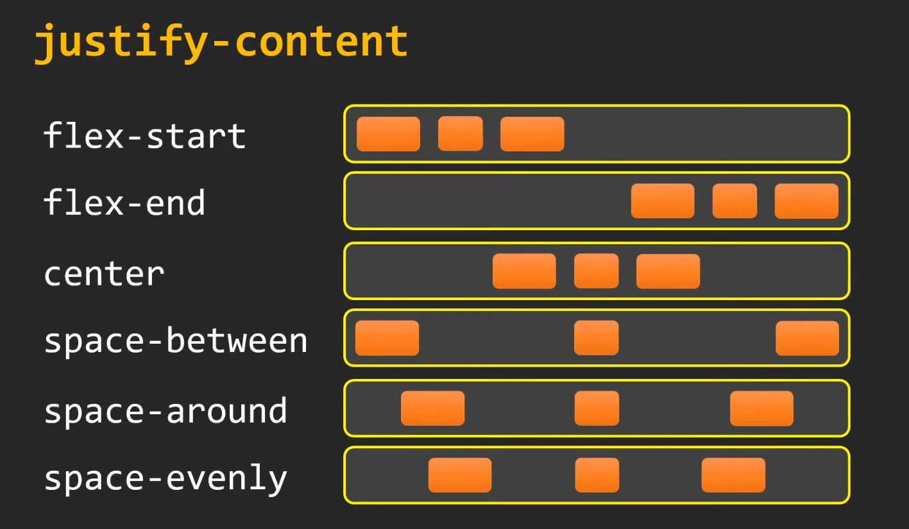
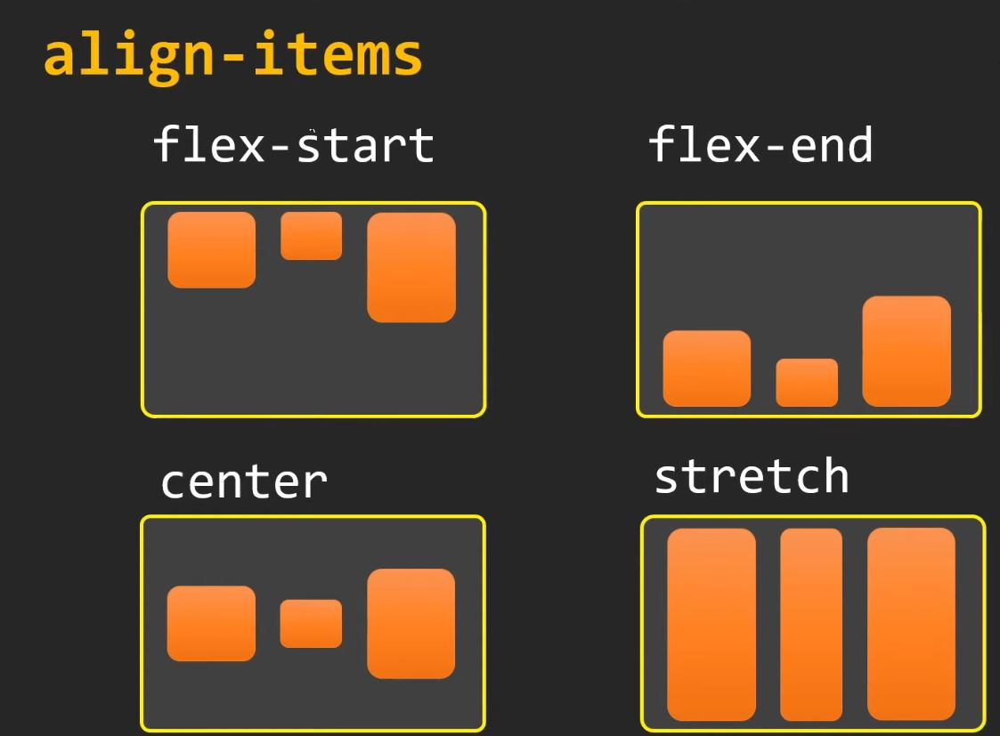
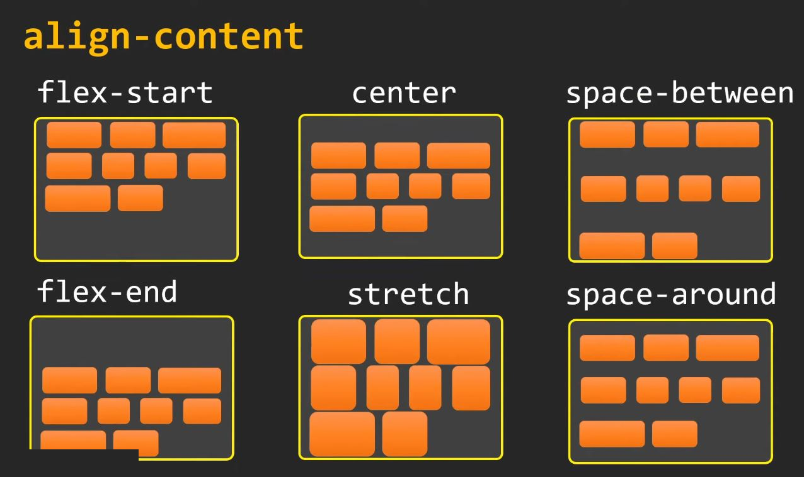
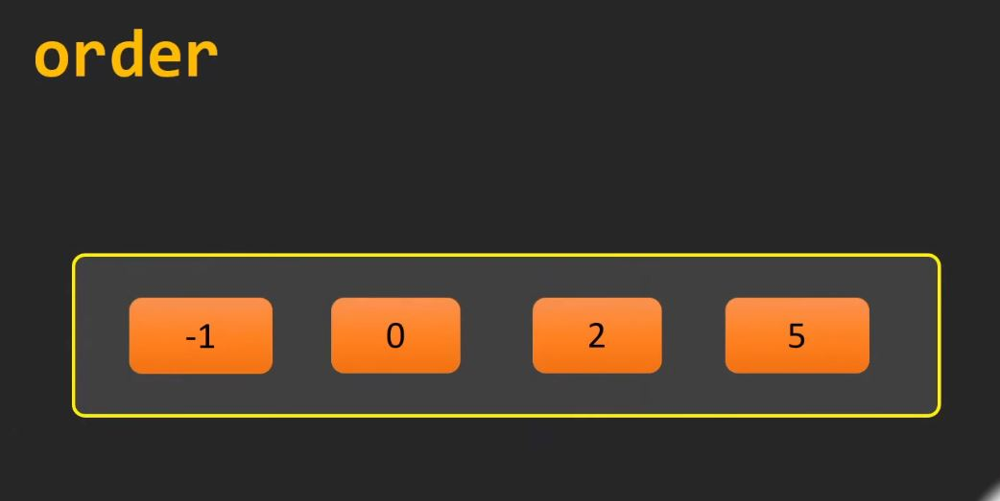
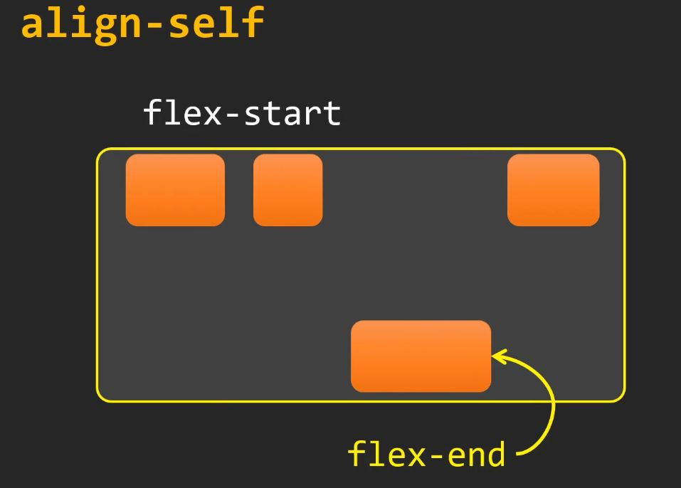

# Guía Flexbox en CSS

## 1. ¿Qué es Flexbox?

Flexbox (Flexible Box Layout) es un modelo de diseño de CSS que permite
organizar y distribuir los elementos dentro de un contenedor. Facilita
la alineación, la distribución del espacio y la adaptación de los
elementos cuando cambia el tamaño disponible.

Para utilizar Flexbox, primero debemos identificar dos elementos:

-   **Contenedor flex:** elemento padre al que se le aplica
    `display: flex`.
-   **Elementos flex:** hijos directos del contenedor. Son los elementos
    que se organizan mediante las propiedades de Flexbox.

### Ejemplo inicial

HTML:

``` html
<div class="flex-container">
  <div>Elemento 1</div>
  <div>Elemento 2</div>
  <div>Elemento 3</div>
</div>
```

CSS:

``` css
.flex-container {
  background-color: #404040;
  border: 2px solid yellow;
  border-radius: 10px;
}

.flex-container > * {
  padding: 10px;
  margin: 10px;
  border: 1px solid black;
  border-radius: 10px;
  background-color: #f18c55;
}
```

En este ejemplo, el selector `.flex-container > *` aplica los estilos a
todos los hijos directos del contenedor. Los bordes y colores permiten
identificar visualmente el contenedor y cada uno de sus elementos.

## 2. Activar Flexbox: `display`

Para activar Flexbox, se utiliza la propiedad `display` en el
contenedor:

``` css
.flex-container {
  display: flex;
}
```

Al aplicar `display: flex`, los hijos directos del contenedor pasan a
organizarse mediante el modelo Flexbox.

También existe `inline-flex`:

``` css
.flex-container {
  display: inline-flex;
}
```

La diferencia está en el comportamiento del propio contenedor frente a
los demás elementos de la página:

-   `flex`: el contenedor se comporta como un elemento de bloque.
-   `inline-flex`: el contenedor se comporta como un elemento en línea.

En ambos casos, sus hijos se organizan mediante Flexbox.

## 3. Dirección de los elementos: `flex-direction`

La propiedad `flex-direction` define la dirección del eje principal y,
por tanto, cómo se organizan los elementos dentro del contenedor.

``` css
.flex-container {
  display: flex;
  flex-direction: row;
}
```

Sus valores principales son:

  -----------------------------------------------------------------------
  Valor                               Comportamiento
  ----------------------------------- -----------------------------------
  `row`                               Organiza los elementos en una fila,
                                      en la dirección del texto. En una
                                      página con dirección LTR,
                                      normalmente de izquierda a derecha.
                                      Es el valor predeterminado.

  `row-reverse`                       Organiza los elementos en una fila,
                                      en dirección contraria a la
                                      dirección del texto.

  `column`                            Organiza los elementos en una
                                      columna, siguiendo el eje vertical
                                      de arriba hacia abajo.

  `column-reverse`                    Organiza los elementos en una
                                      columna en sentido inverso.
  -----------------------------------------------------------------------



Ejemplo:

``` css
.flex-container {
  display: flex;
  flex-direction: column;
}
```

**Importante:** `flex-direction` define el eje principal. Cuando se
cambia de `row` a `column`, también cambia la orientación de los ejes
que se utilizan para alinear los elementos.





## 4. Ajuste de líneas: `flex-wrap`

Por defecto, Flexbox intenta mantener los elementos en una sola línea.
La propiedad `flex-wrap` permite definir si los elementos pueden pasar a
una nueva línea cuando no hay espacio suficiente.

``` css
.flex-container {
  display: flex;
  flex-wrap: wrap;
}
```

Sus valores son:

  -----------------------------------------------------------------------
  Valor                               Comportamiento
  ----------------------------------- -----------------------------------
  `nowrap`                            Mantiene los elementos en una sola
                                      línea. Es el valor predeterminado.

  `wrap`                              Permite que los elementos pasen a
                                      una nueva línea cuando no hay
                                      espacio suficiente.

  `wrap-reverse`                      Permite varias líneas, pero las
                                      distribuye en sentido inverso sobre
                                      el eje transversal.
  -----------------------------------------------------------------------

Ejemplo:

``` css
.flex-container {
  display: flex;
  flex-wrap: wrap;
}
```

Si el contenedor no tiene espacio suficiente para mostrar todos los
elementos en una sola línea, con `wrap` estos pueden pasar a la
siguiente.



**Nota:** `nowrap` es un valor de `flex-wrap`, no de `flex-direction`.

## 5. Alineación sobre el eje principal: `justify-content`

La propiedad `justify-content` distribuye los elementos sobre el eje
principal del contenedor. La orientación de este eje depende de
`flex-direction`.

``` css
.flex-container {
  display: flex;
  justify-content: center;
}
```

Valores principales:

  -----------------------------------------------------------------------
  Valor                               Comportamiento
  ----------------------------------- -----------------------------------
  `flex-start`                        Agrupa los elementos al inicio del
                                      eje principal. Es el valor
                                      predeterminado.

  `flex-end`                          Agrupa los elementos al final del
                                      eje principal.

  `center`                            Agrupa los elementos en el centro
                                      del eje principal.

  `space-between`                     Distribuye los elementos dejando
                                      espacio entre ellos. No deja
                                      espacio adicional en los extremos.

  `space-around`                      Distribuye espacio alrededor de
                                      cada elemento.

  `space-evenly`                      Distribuye el espacio de manera
                                      uniforme entre los elementos y los
                                      extremos del contenedor.
  -----------------------------------------------------------------------



Ejemplo:

``` css
.flex-container {
  display: flex;
  justify-content: space-between;
}
```

**Para recordar:** `justify-content` trabaja sobre el eje principal. Si
`flex-direction` es `row`, normalmente se percibe como una distribución
horizontal; si es `column`, como una distribución vertical.

## 6. Alineación de elementos sobre el eje transversal: `align-items`

La propiedad `align-items` define cómo se alinean los elementos en el
eje transversal. Este eje es perpendicular al eje principal.

``` css
.flex-container {
  display: flex;
  align-items: center;
}
```

Valores principales:

  -----------------------------------------------------------------------
  Valor                               Comportamiento
  ----------------------------------- -----------------------------------
  `stretch`                           Estira los elementos para ocupar el
                                      espacio disponible en el eje
                                      transversal, siempre que sus
                                      dimensiones y márgenes lo permitan.
                                      Es el valor predeterminado.

  `flex-start`                        Alinea los elementos al inicio del
                                      eje transversal.

  `flex-end`                          Alinea los elementos al final del
                                      eje transversal.

  `center`                            Alinea los elementos en el centro
                                      del eje transversal.
  -----------------------------------------------------------------------



Ejemplo:

``` css
.flex-container {
  display: flex;
  height: 300px;
  align-items: center;
}
```

En este ejemplo se asigna una altura al contenedor para que se pueda
observar el espacio disponible en el eje transversal cuando la dirección
es `row`.

**Importante:** `align-items` no siempre representa una alineación
vertical. Con `flex-direction: column`, el eje transversal es
horizontal.

## 7. Alineación de varias líneas: `align-content`

La propiedad `align-content` controla cómo se distribuyen las líneas de
elementos en el eje transversal cuando el contenedor tiene varias
líneas.

Para observar su efecto, normalmente se necesita:

-   Que el contenedor permita varias líneas mediante `flex-wrap: wrap`.
-   Que los elementos ocupen más de una línea.
-   Que exista espacio libre en el eje transversal dentro del
    contenedor.

``` css
.flex-container {
  display: flex;
  flex-wrap: wrap;
  align-content: center;
  height: 400px;
}
```

Valores principales:

  -----------------------------------------------------------------------
  Valor                               Comportamiento
  ----------------------------------- -----------------------------------
  `flex-start`                        Agrupa las líneas al inicio del eje
                                      transversal.

  `flex-end`                          Agrupa las líneas al final del eje
                                      transversal.

  `center`                            Agrupa las líneas en el centro del
                                      eje transversal.

  `space-between`                     Distribuye las líneas dejando
                                      espacio entre ellas, sin espacio
                                      adicional en los extremos.

  `space-around`                      Distribuye espacio alrededor de
                                      cada línea.

  `space-evenly`                      Distribuye el espacio de manera
                                      uniforme entre las líneas y los
                                      extremos.

  `stretch`                           Estira las líneas para ocupar el
                                      espacio disponible. Es el valor
                                      predeterminado.
  -----------------------------------------------------------------------



**Diferencia entre `align-items` y `align-content`:**

-   `align-items` alinea los elementos dentro de cada línea.
-   `align-content` distribuye las líneas completas cuando hay varias.

Por eso, `align-content` no tiene un efecto visible cuando todos los
elementos están en una sola línea.

## 8. Cambiar el orden visual: `order`

La propiedad `order` permite cambiar el orden visual de un elemento flex
sin modificar la estructura del HTML.

``` css
.elemento-1 {
  order: 2;
}

.elemento-2 {
  order: 1;
}

.elemento-3 {
  order: 0;
}
```

Los elementos se muestran de menor a mayor valor de `order`.

-   `order: 0` es el valor predeterminado.
-   Un elemento con `order: 1` se muestra después de uno con `order: 0`.
-   Los valores pueden ser positivos o negativos.

Si varios elementos tienen el mismo valor, conservan entre ellos el
orden que tienen en el HTML.



**Importante:** `order` modifica el orden visual, pero no cambia el
orden del contenido en el HTML ni necesariamente el orden en que se
recorre con el teclado o tecnologías de asistencia. Por accesibilidad,
conviene que el orden visual siga siendo coherente con el orden del
documento.

## 9. Alineación individual: `align-self`

La propiedad `align-self` permite modificar la alineación de un elemento
flex específico sobre el eje transversal, sin cambiar la alineación
definida para los demás elementos mediante `align-items`.

``` css
.elemento-destacado {
  align-self: center;
}
```

Valores principales:

  -----------------------------------------------------------------------
  Valor                               Comportamiento
  ----------------------------------- -----------------------------------
  `auto`                              Hereda el comportamiento de
                                      `align-items` del contenedor. Es el
                                      valor predeterminado.

  `flex-start`                        Alinea el elemento al inicio del
                                      eje transversal.

  `flex-end`                          Alinea el elemento al final del eje
                                      transversal.

  `center`                            Alinea el elemento en el centro del
                                      eje transversal.

  `stretch`                           Estira el elemento para ocupar el
                                      espacio disponible, si sus
                                      dimensiones lo permiten.
  -----------------------------------------------------------------------

Ejemplo:

``` css
.flex-container {
  display: flex;
  align-items: flex-start;
  height: 300px;
}

.elemento-2 {
  align-self: center;
}
```

En este ejemplo, todos los elementos se alinean al inicio del eje
transversal, excepto el segundo, que se ubica en el centro.



## 10. Resumen: contenedor y elementos hijos

Es importante identificar a qué elemento se aplica cada propiedad:

  -----------------------------------------------------------------------
  Se aplica al contenedor             Se aplica a los elementos hijos
  (`display: flex`)                   
  ----------------------------------- -----------------------------------
  `flex-direction`                    `order`

  `flex-wrap`                         `align-self`

  `justify-content`                   

  `align-items`                       

  `align-content`                     
  -----------------------------------------------------------------------

## 11. Ejemplo integrado

El siguiente ejemplo reúne varias de las propiedades explicadas:

HTML:

``` html
<div class="flex-container">
  <div class="item item-1">Elemento 1</div>
  <div class="item item-2">Elemento 2</div>
  <div class="item item-3">Elemento 3</div>
  <div class="item item-4">Elemento 4</div>
</div>
```

CSS:

``` css
.flex-container {
  display: flex;
  flex-direction: row;
  flex-wrap: wrap;
  justify-content: space-evenly;
  align-items: center;
  align-content: space-around;

  min-height: 400px;
  background-color: #404040;
  border: 2px solid yellow;
  border-radius: 10px;
}

.item {
  padding: 20px;
  margin: 10px;
  border: 1px solid black;
  border-radius: 10px;
  background-color: #f18c55;
}

.item-2 {
  order: 1;
  align-self: flex-end;
}
```

Puedes modificar los valores de las propiedades para observar cómo
cambia la distribución y alineación de los elementos.

------------------------------------------------------------------------

## Recomendaciones para practicar

1.  Cambia `flex-direction` entre `row` y `column`. Observa cómo cambia
    el eje principal.
2.  Reduce el ancho del contenedor y prueba `flex-wrap: nowrap` y
    `flex-wrap: wrap`.
3.  Prueba diferentes valores de `justify-content` y compara la
    distribución del espacio.
4.  Asigna una altura al contenedor y experimenta con `align-items`.
5.  Genera varias líneas de elementos y compara `align-items` con
    `align-content`.
6.  Cambia el valor de `order` de varios elementos y observa cómo cambia
    su orden visual.
7.  Utiliza `align-self` para alinear un solo elemento de manera
    diferente a los demás.

**Consejo:** modifica una propiedad a la vez y observa el resultado. Así
podrás identificar con mayor facilidad qué controla cada propiedad.
